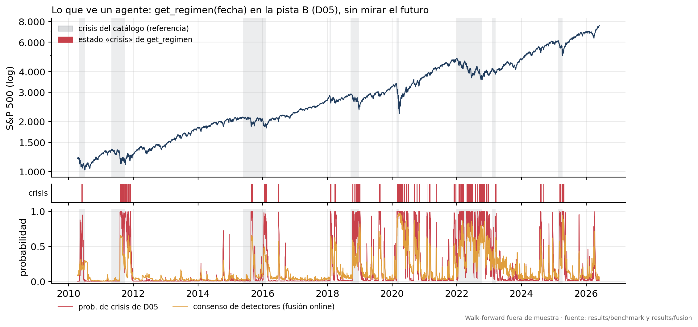
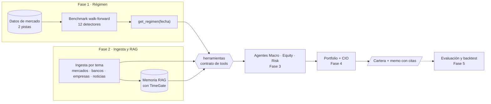
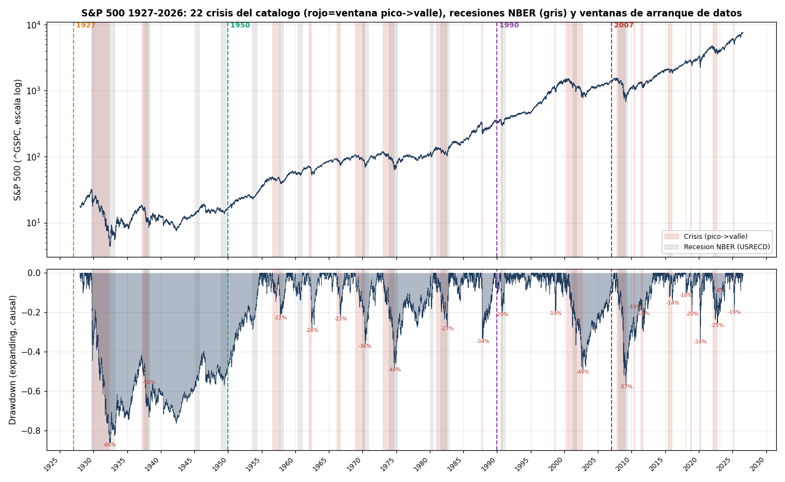

<div align="center">

# regime-aware-macro-equity

**Sistema multi-agente con RAG para invertir según el régimen de mercado**

*Multi-Agent RAG System for Regime-Aware Macro-Equity Intelligence* · Trabajo Fin de Máster (MIAX)

[](https://github.com/Romequinco/regime-aware-macro-equity/actions/workflows/tests.yml)


</div>

<p align="center">
  
</p>

Un equipo de **agentes** (Macro, Equity, Risk, Portfolio y CIO, orquestados con LangGraph) lee información
financiera con su fecha de publicación, sabe en qué **régimen** está el mercado y con ello propone una **cartera**
explicada en un *investment memo* con citas. Ningún agente puede mirar el futuro: cada dato y cada tool respetan
la fecha de la decisión (TimeGate).

La figura de arriba es la pieza que ya funciona: la tool **`get_regimen(fecha)`** de la Fase 1, tal como la vería un
agente cada día desde 2010, evaluada fuera de muestra.

## Arquitectura



Los agentes solo hablan con [`src/herramientas`](src/herramientas/README.md): un catálogo de tools tipadas en el
que **la fecha la fija el sistema, nunca el modelo de lenguaje**. Así el detector de régimen o una fuente de datos
pueden cambiar sin tocar a los agentes ([ADR-012](docs/decisions/ADR-012-estructura-repo.md)).

## Hoja de ruta

| Fase | Qué construye | Estado |
|:---:|---|:---:|
| 1 | **Régimen de mercado**: datos causales, comparativa de detectores, tool `get_regimen(fecha)` | 🟡 en cierre |
| 2 | **Ingesta, RAG y tools**: corpus con fecha de publicación, memoria RAG, contrato de tools | 🟡 en marcha |
| 3 | **Agentes Macro, Equity y Risk** en LangGraph, con salidas estructuradas y trazables | ⏳ pendiente |
| 4 | **Cartera y memo**: Portfolio y CIO, motores basados en riesgo, límites del cliente | ⏳ pendiente |
| 5 | **Evaluación**: backtest con TimeGate frente a *baselines* y calidad de los memos | ⏳ pendiente |

Detalle y siguiente paso de cada fase en [`docs/tfm/README.md`](docs/tfm/README.md#3-plan-de-trabajo-cinco-fases-y-su-estado).

## Fase 1 en cifras

| | Pista A · potencia | Pista B · riqueza |
|---|:---:|:---:|
| Periodo | 1962 – 2026 | 2007 – 2026 |
| Series de entrada | 41 | 106 |
| Crisis evaluadas fuera de muestra | 17 | 9 |
| Detectores comparados | 12 de 7 familias | 12 de 7 familias |
| Detector de `get_regimen` (primero del MCS) | **D06** · GJR-GARCH-t | **D05** · Markov-Switching |

Todo se evalúa con **walk-forward causal**: z-scores con ventana expansiva, retrasos de publicación de cada serie y
las mismas métricas de detección para todos los detectores. Además de su estado, `get_regimen` devuelve un
**contexto** para los agentes: la probabilidad de crisis según el consenso de todos los detectores (fusión online)
y cuántos de ellos coinciden. Ranking completo en [`results/benchmark/ranking_v2.csv`](results/benchmark/ranking_v2.csv)
y en el notebook [`14_comparativa`](notebooks/fase1/14_comparativa.ipynb); decisiones en los ADR-008 a ADR-011.

<details>
<summary><b>Catálogo de crisis 1927–2026</b> (la referencia contra la que se mide cada detector)</summary>
<br>

</details>

> La línea de **datos sintéticos** (notebooks 17–20: 10 generadores, validación por niveles, laboratorio con régimen
> conocido y aumento pre-registrado) se cerró con un resultado negativo bien medido: **el aumento no se adopta** y
> `get_regimen` no cambia. Método en [`docs/fase1/sinteticos.md`](docs/fase1/sinteticos.md).

## Inicio rápido

```bash
git clone https://github.com/Romequinco/regime-aware-macro-equity.git
cd regime-aware-macro-equity
python -m pip install -e ".[dev]" -c constraints.txt
```

```python
from datetime import date
from herramientas import invocar

r = invocar("get_regimen", {}, fecha=date(2020, 3, 16))
r.estado, r.detector, r.dias_en_estado, r.contexto.lectura
# ('crisis', 'D05', 16, 'crisis respaldada')   ← 15 de 17 detectores coinciden
r.citas[0].fuente
# 'results/benchmark/panels/B_D05.parquet'     ← cada respuesta cita su origen con su sha256
```

## Instalación

Esta es la fuente única de instalación del repositorio. Todas las dependencias están en
[`pyproject.toml`](pyproject.toml) (distribución `regime-aware-macro-equity`; paquetes `regimenes`, `ingesta` y
`herramientas`), con un extra por uso, y el candado de versiones en [`constraints.txt`](constraints.txt).

```bash
cp .env.example .env                                          # FRED_API_KEY, SEC_EDGAR_USER_AGENT, INGESTA_CORPUS_DIR
python -m pip install -e ".[todo]" -c constraints.txt         # todo: deep, jump, changepoint, dev e ingesta
```

Variantes, siempre con `-c constraints.txt`:

| Para qué | Extras |
|---|---|
| Desarrollo sin torch ni jumpmodels (D12 y D09 se saltan) | `".[dev]"` |
| Fase 2 completa | `".[dev,ingesta]"` |
| Un solo tema de la Fase 2 | `".[dev,ingesta-mercados]"` · `".[dev,ingesta-bancos]"` · `".[dev,ingesta-noticias]"` (empresas no necesita extra) |

> [!IMPORTANT]
> **Usa siempre el candado.** La caché del benchmark guarda una huella con las versiones de numpy, pandas, scipy,
> scikit-learn, hmmlearn, arch, torch y jumpmodels. Si `pip` actualiza cualquiera de ellas, toda la caché queda
> invalidada y hay que re-ejecutar el benchmark (horas). `requirements.txt` es solo un alias de una línea.

<details>
<summary><b>Si ya tenías el repo clonado</b> (antes del renombrado a <code>regime-aware-macro-equity</code>)</summary>

La distribución dejó de llamarse `regimenes`. Hay que reinstalar una vez:

```bash
git remote set-url origin https://github.com/Romequinco/regime-aware-macro-equity.git
git fetch
git switch main && git pull
python -m pip uninstall -y regimenes                          # quita la distribución antigua
python -m pip install -e ".[todo]" -c constraints.txt         # o los extras de tu tema
# si existe, borra la carpeta src/regimenes.egg-info (metadatos de la distribución antigua)
python -c "import regimenes, ingesta, herramientas"
python -m pytest -q -m "not datos and not resultados"
```

La carpeta local puede seguir llamándose como antes: el nombre del directorio no afecta a nada.
</details>

## Estructura del repositorio

```
regime-aware-macro-equity/
├── configs/        configuración de la Fase 1 (benchmark, bloques, catálogo de series, régimen)
├── data/           datos crudos y procesados (fuera de git)
├── src/
│   ├── regimenes/      Fase 1 · régimen de mercado → get_regimen
│   ├── ingesta/        Fase 2 · ingesta por tema
│   └── herramientas/   contrato de tools para los agentes
│                       (memoria/, agentes/ y cartera/ se crean al empezar cada fase)
├── notebooks/
│   ├── fase1/      00–22 (datos, detectores, fusiones, sintéticos, decisión)
│   └── fase2/      un subdirectorio por tema: <tema>/NN_*.ipynb
├── results/        resultados pequeños versionados
├── tests/          espejo de src/
└── docs/           índice, decisiones (ADR), estado del arte y una carpeta por fase
```

## Cómo reproducir

Objetivos del [`Makefile`](Makefile) (GNU Make; en Windows, bajo Git Bash). `make help` los lista.

| Objetivo | Qué hace |
|---|---|
| `make install` | entorno completo con el candado |
| `make datos` | verifica `data/raw/` sin red (`DESCARGAR=1` descarga lo que falte) |
| `make features` | regenera `data/processed/` (notebook 03) |
| `make benchmark JOBS=4` | benchmark de 12 detectores × 2 pistas con caché verificada |
| `make notebooks` | ejecuta los notebooks 00–16 en orden |
| `make test` · `make test-rapido` | tests completos · sin datos ni resultados locales |
| `make lint` | errores reales con ruff |

La figura de portada se regenera con `python -m regimenes.viz.portada`. Tras un benchmark nuevo, el orden de los
notebooks no es el numérico: ver [`docs/fase1/README.md`](docs/fase1/README.md#orden-de-ejecución).

## Documentación

| Para… | Empieza por |
|---|---|
| Entender el TFM y su estado | [`docs/tfm/README.md`](docs/tfm/README.md) |
| Orientarte en toda la documentación | [`docs/README.md`](docs/README.md) |
| El código de la Fase 1, módulo a módulo | [`src/regimenes/README.md`](src/regimenes/README.md) |
| Construir agentes sobre las tools | [`src/herramientas/README.md`](src/herramientas/README.md) |
| Trabajar en la ingesta | [`docs/fase2/README.md`](docs/fase2/README.md) |
| Las decisiones y por qué | [`docs/decisions/`](docs/decisions) |
| Un término que no conoces | [`docs/GLOSARIO.md`](docs/GLOSARIO.md) |

## Equipo

**Óscar Romero Quincoces** · **Daniel García** · **Fernando Dapena Tauste**

Trabajo Fin de Máster (MIAX).

## Licencia

[MIT](LICENSE).
