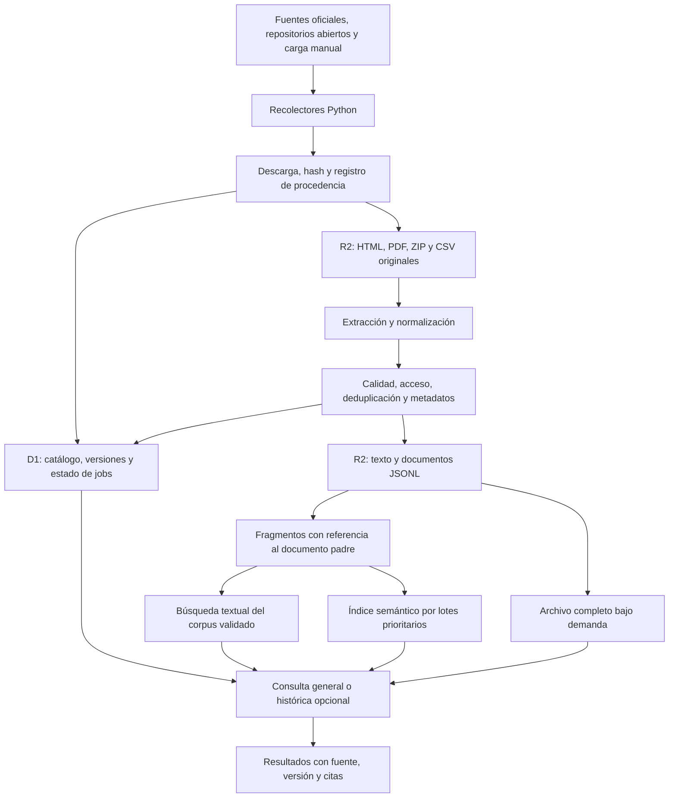

# Arquitectura del corpus y del pipeline

## Objetivo

Recopilar las familias de información de la imagen: comunicaciones de bancos
centrales, informes de estabilidad, organismos multilaterales, papers de crisis,
literatura de cartera y documentos regulatorios. Conservar los originales y
construir una biblioteca amplia para agentes: búsqueda de evidencias, lectura
de documentos completos y RAG progresivo. Cobertura y utilidad de consulta son
prioritarias; no se exige ingesta inmediata. Las consultas históricas son un
modo opcional que respeta la información disponible en la fecha solicitada.

El objetivo y los criterios de consulta están en
[Corpus de conocimiento para agentes](corpus_para_agentes.md).

## Flujo propuesto



## Qué hace cada componente

| Componente | Responsabilidad |
|---|---|
| Python | Recolección, PDF/OCR, extracción de tablas, normalización y procesamiento por lotes |
| R2 | Almacenar bytes originales y artefactos grandes con rutas reproducibles |
| D1 | Consultar metadatos por fuente, familia, tema, fecha, versión y estado |
| GitHub Actions | Ejecutar inicialmente lotes acotados y refrescos programados |
| Worker opcional | API privada de consulta o coordinación ligera |
| Búsqueda textual | Recuperar términos, autores e identificadores en textos validados; motor por decidir en el piloto |
| Índice vectorial opcional | Recuperar pasajes por significado; ampliar cobertura según calidad y coste |

Los originales y los textos no van en Git. R2 conserva el corpus; D1 mantiene
las referencias para encontrarlo. Los embeddings no se almacenarán en una tabla
D1 como sustituto de un motor de búsqueda vectorial. Antes de adoptar Vectorize
u otro índice, se medirá volumen, coste, relevancia de resultados y soporte de
filtros. La elección del motor de búsqueda queda pendiente del piloto; R2
conserva archivos y D1 sus metadatos, pero eso no resuelve por sí solo la búsqueda.

## Etapas y recuperación

1. **Descubrir:** guardar URL, fuente y señal de publicación; checkpoint por fuente.
2. **Descargar:** respetar límites y condiciones de acceso, registrar resultado
   HTTP, tipo y tamaño. Validar que un supuesto PDF no sea una página de bloqueo.
3. **Conservar:** calcular SHA-256, guardar el original y registrar la versión.
4. **Extraer:** conservar párrafos, páginas, títulos, autores y estructura Q&A;
   OCR solo cuando sea necesario y con calidad registrada.
5. **Normalizar:** producir documentos JSONL con un contrato versionado.
6. **Validar:** idioma, acceso, términos, completitud, duplicados y trazabilidad;
   registrar fechas conocidas e incertidumbres, sin exigir precisión histórica
   extrema para la consulta general.
7. **Catalogar:** guardar metadatos y referencias de objetos; marcar la versión ready.
8. **Fragmentar e indexar:** texto validado localizable; embeddings por lotes
   prioritarios y reglas de segmentación según familia.
9. **Consultar o analizar:** devolver pasajes y contexto con citas al original
   y versión. Activar TimeGate solo para solicitudes históricas explícitas.

Estados propuestos: discovered, fetched, extracted, validated, ready, failed,
manual_required y quarantined. Cada etapa debe poder repetirse sin duplicar datos.
R2 y D1 no comparten una transacción global: un lote debe tolerar objetos escritos
sin catálogo confirmado y reconciliarlos al reanudarse. Los resultados solo serán
visibles para consulta cuando su versión esté validada y marcada ready. El
estado de indexación textual/semántica y la aptitud para evaluación histórica
se registran por separado: no tener embeddings o una fecha pública exacta no
impide que un texto validado sea útil en consulta general.

## Organización de objetos en cada bucket

```text
raw/<fuente>/<año>/<sha256>.<extensión>
normalized/<fuente>/<año>/<lote>.jsonl
chunks/<fuente>/<año>/<lote>.jsonl
manifests/<fecha>/<run-id>.jsonl
derived/<tipo>/<versión-pipeline>/<run-id>.jsonl
```

Esta es una convención de claves, no objetos ya subidos. Los textos derivados
deben enlazar al hash y versión del original. Un manifiesto recoge objetos,
hashes, conteos y estados, sin secretos. Un mismo contenido puede reutilizarse
entre documentos, conservando por separado cada procedencia y fecha.

## Ejecución sin depender del ordenador

Al implementar, GitHub Actions ofrecerá ejecución manual del piloto y una
programación incremental sin requisitos de ejecución inmediata. Propuesta:
refrescos semanales para comunicaciones y mensuales para literatura, ajustables
tras medir el piloto. La carga retrospectiva se dividirá por fuente y año,
con checkpoints persistidos en D1/R2; no dependerá del disco temporal del runner.
Las tareas costosas de OCR se separarán de los refrescos ligeros.

Los cron de GitHub pueden retrasarse y no garantizan ejecutar al minuto exacto.
Para cargas grandes se evaluará un ejecutor dedicado o una cola según volumen
y coste; el objetivo actual no requiere ejecución al minuto.
La elección final debe revisar minutos disponibles y coste de la cuenta GitHub.

Referencia: [ejecuciones programadas de GitHub Actions](https://docs.github.com/en/actions/reference/workflows-and-actions/events-that-trigger-workflows#schedule).

## RAG y análisis de la imagen

- Bancos centrales: empezar por párrafos de 60–350 palabras y Q&A por pregunta,
  ajustando la longitud con muestras reales.
- Informes: fragmentos por sección, hasta aproximadamente 800 tokens, más vínculo
  al padre. Son parámetros iniciales, no límites universales.
- Registrar tokenizer, versión de reglas, página y posición de cada fragmento.
- Hacer localizable el texto validado mediante catálogo y búsqueda textual.
  Incorporar embeddings por lotes prioritarios y ampliar el RAG según utilidad
  y coste; conservar acceso al documento completo y al contexto de cada pasaje.
- Entregar título, fuente, versión, fecha conocida, página/sección y URL en cada
  resultado. Evaluar relevancia y respaldo de las citas con preguntas de referencia.
- Tono hawkish/dovish y diferencias entre comunicados son resultados derivados:
  conservar método, modelo, prompt, versión y documentos de entrada.
- Cada resultado debe distinguir texto fuente de interpretación generada.

## Límites de acceso

Las etiquetas de bloqueo de la imagen sirven para reservar carga manual y
revisar el acceso actual. Ante autenticación, bloqueo o paywall, se registrará
la causa y se buscará una API, feed o descarga autorizada. No se diseñan saltos
de controles de acceso. La licencia y las condiciones de redistribución se
registrarán por fuente/documento; una copia pública no implica permiso universal
para redistribuirla.


## Configuración prevista

- `sources/`: un registro por fuente con listado oficial, método permitido,
  tipos de documentos, formatos, temas, prioridad y frecuencia de lotes.
- `policies/`: calidad, deduplicación, acceso, indexación progresiva, retención
  y modo histórico opcional. Propuesta de refresco semanal/mensual, ajustable.
- `environments/`: nombres de buckets, IDs de catálogo y parámetros no secretos
  de desarrollo y producción.

El inventario ejecutable está en `src/ingesta/bancos_riesgo/config/sonda_fuentes.json`.
Las políticas y entornos adicionales se escribirán al implementar. El inventario
inicial está en [inventario de fuentes](fuentes.md). Las credenciales pertenecerán a `.env` local
ignorado o al gestor de secretos del ejecutor, no a estas carpetas.


## Módulos de la sonda y ampliaciones

`sonda/` implementa las consultas pequeñas del notebook: HTTP con caché de
originales, adaptadores de documentos/tablas/APIs, extracción, política temporal,
mediciones y gráficos. `ConfigSonda` limita volumen y páginas; `Sonda.ejecutar`
mantiene independiente cada apartado. El inventario declarativo vive en
`src/ingesta/bancos_riesgo/config/sonda_fuentes.json`.

La adquisición no convierte fechas de evento o periodos en publicación.
Las versiones de portales actuales conservan sus fechas conocidas, pero no
entran en el TimeGate estricto hasta acreditar el texto histórico. arXiv fija
la descarga a v1. Las pruebas de `tests/ingesta/bancos_riesgo/` cubren los límites temporales.

La tabla siguiente describe módulos futuros del tema; las carpetas vacías del
proyecto original se han eliminado. R2/D1 y el recolector masivo siguen pendientes.

| Carpeta | Trabajo que contendrá |
|---|---|
| collectors | Adaptadores por institución: listar e identificar documentos |
| fetching | Cliente HTTP, descargas, hashes, reintentos y límites de peticiones |
| parsing | Extracción HTML/PDF/tablas y OCR selectivo |
| normalization | Contrato común, idioma, fechas y calidad |
| storage | Repositorios R2 y D1; claves de objetos y manifiestos |
| temporal | Fechas y versiones; TimeGate opcional para evaluación histórica |
| chunking | Fragmentos de párrafo, Q&A y sección, con vínculo al padre |
| retrieval | Búsqueda textual/semántica, filtros temáticos, contexto, citas y documento completo |
| analysis | Tono, diferencias entre comunicados y derivados de crisis |
| orchestration | Jobs, checkpoints, estados e idempotencia |

Los adaptadores de fuentes no accederán directamente a credenciales ni a SQL:
utilizarán los contratos y la capa de almacenamiento. Los módulos de consulta
aplicarán filtros de acceso y calidad a documentos y fragmentos. La consulta
general será el modo predeterminado; las reglas temporales estrictas se aplicarán
cuando se solicite el modo histórico.


## Ejecución por lotes prevista

`ejecutar_notebook_sonda.py` ejecuta el cuaderno completo con el kernel local y
guarda sus salidas. `exportar_notebook.py` sincroniza Markdown y HTML desde ese
notebook, sin repetir consultas de red, en `<INGESTA_CORPUS_DIR>/bancos_riesgo/exports/notebooks/`.
Se invocan como módulos `python -m ingesta.bancos_riesgo.jobs.<nombre_sin_extension>`.

La recolección masiva y los calendarios de refresco descritos abajo siguen
pendientes; estos dos scripts solo ejecutan y exportan la sonda.

Se distinguirán descubrimiento, refresco incremental, backfill histórico,
importación manual, extracción, fragmentación y reconciliación de catálogo.
Cada job tendrá fuente, rango, límites, checkpoint y versión de configuración.

Priorizar cargas amplias reanudables y descargas oficiales masivas. Incorporar
indexación textual, embeddings por lotes y medición de cobertura por familia.
Frecuencia propuesta: semanal para comunicaciones y mensual para literatura;
ajustar según consumo y utilidad. No hay requisito de ejecución inmediata.

Los ejecutores actuales viven en `src/ingesta/bancos_riesgo/jobs/`; la lógica
de los futuros lotes pertenecerá al paquete del tema. Los calendarios se activarán en el ejecutor
solo después de verificar acceso y consumo. No hay jobs masivos ni programados.


## Contratos y migraciones previstos

Se definirán contratos dentro del paquete del tema para documento, versión, observación de fuente,
fragmento, manifiesto de ejecución y resultado derivado. Serán versionados y
validarán los JSONL escritos en R2.

El modelo conceptual está en [modelo y TimeGate](modelo_y_timegate.md). Las migraciones SQL
del catálogo D1 se incorporarán al tema cuando se implemente; no hay migraciones todavía.


## Validación del futuro pipeline

Las reglas temporales de la sonda tienen pruebas ejecutables en
`tests/ingesta/bancos_riesgo/test_sonda_temporal.py`: fechas parciales, zonas, límite del siguiente día
local, versiones sin acreditar, texto parcial, exclusión de publicaciones
futuras y retrasos firmados. Ejecutar desde la raíz:

```powershell
python -m pytest tests/ingesta/bancos_riesgo -q
```

La ejecución real de los 14 apartados comprueba sus adaptadores y gráficos;
los errores HTTP quedan en los resultados y no se confunden con éxitos.

- `unit/`: extracción, normalización, hashing, claves, fechas, TimeGate y reglas
  de fragmentación con muestras pequeñas.
- `integration/`: subida/descarga R2, catálogo D1, reejecución y recuperación de
  escrituras parciales, solo contra desarrollo.
- `fixtures/`: muestras pequeñas sintéticas o con licencia que permita guardarlas
  en Git; sin credenciales ni corpus de producción.

La verificación principal del corpus usará preguntas de referencia de varias
familias: recuperar pasajes pertinentes, abrir su contexto y comprobar que la
cita respalda la afirmación. Incluir fuentes discrepantes y preguntas sin evidencia.
Comprobar que un documento validado sin fecha pública exacta puede consultarse
en modo general, mientras un fallo grave de extracción no se presenta como texto listo.

La prueba del modo histórico opcional usará dos versiones del mismo documento y una fecha
de corte intermedia: la versión publicada después debe quedar excluida tanto
de búsqueda como del análisis derivado. Las integraciones R2/D1 siguen pendientes.
